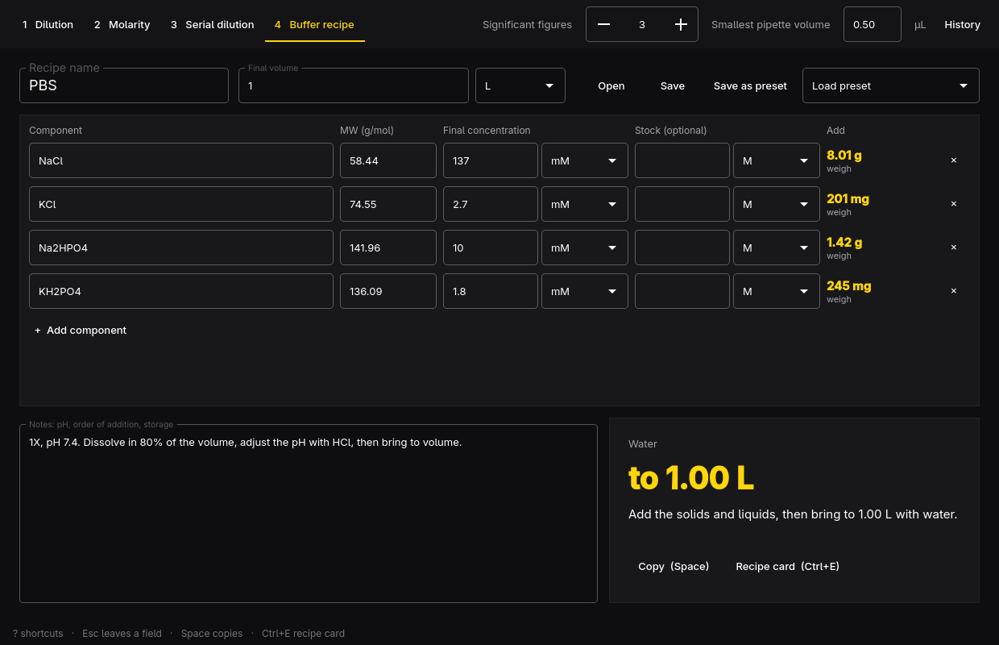

# Dilute

The everyday lab solution math, done without mistakes: dilutions, molarity,
serial dilutions and buffer recipes, with live results and a recipe card to
take to the bench.



Four calculators, one per key:

1. **Dilution**: C1V1 = C2V2. Fill in any three and the fourth is worked out,
   with the diluent to add.
2. **Molarity**: mass, moles, concentration and volume, tied by a molecular
   weight typed in or picked from an editable reagent list (NaCl, Tris base,
   EDTA, glucose, KCl, MgCl2·6H2O and more).
3. **Serial dilution**: a start concentration, factor, number of tubes and
   transfer volume give each tube's concentration and volumes.
4. **Buffer recipe**: components at final concentrations, made up to a
   volume. Each is weighed, pipetted from a stock, or added neat (%(v/v)).
   Presets for PBS, TAE, TBE, TE, Tris-HCl and RIPA, all editable; save your
   own as presets or as `.dilute` files.

Units are M, mM, µM, nM, pM; g/L, mg/mL, µg/mL, ng/µL, %(w/v); %(v/v); X
stocks (10X → 1X); g to ng; mol to pmol; L, mL, µL. Units that don't convert
into each other, such as mM and mg/mL without a molecular weight, show an
error, never a wrong number. Results follow the significant figures you set,
and volumes under the smallest you can pipette (0.5 µL unless you change it)
are flagged. Recent calculations are kept in the history.

Ctrl+E shows the recipe card, with the date, the components, the amounts and
a box to tick for each, and saves it as PDF or SVG to print.

Dilute follows the Omarchy theme and language as they change.

## Keys

Single-key shortcuts go to the window, not to a field you're typing in: press
Esc to leave the field first, or use Ctrl+1–4 to switch calculators from
anywhere.

| Key | Action |
| --- | --- |
| 1–4, Ctrl+1–4 | Switch calculator |
| Tab, Shift+Tab | Next or previous field |
| Esc | Leave the field |
| Space | Copy the main result (the whole table for a serial dilution) |
| N | New calculation or recipe |
| Ctrl+S | Save as a `.dilute` recipe |
| Ctrl+O | Open a recipe |
| Ctrl+E | Recipe card as PDF or SVG |
| Ctrl+Z, Ctrl+Shift+Z | Undo and redo recipe edits |
| H | History |
| ? | All shortcuts |
| Q | Quit (asks first if the recipe isn't saved) |

## Command line

Every calculator works without a window, for scripts and agents. Each command
takes `--json`, exits 0 on success and 1 on failure, with errors on stderr.

```sh
dilute c1v1 --c1 10mM --c2 1mM --v2 50mL
dilute mass --mw 58.44 --conc 150mM --vol 1L
dilute serial --start 1mM --factor 10 --steps 6 --vol 100uL
dilute recipe pbs --vol 500mL
dilute recipe my-buffer.dilute --json
dilute convert 150mM --to mg/mL --mw 58.44
dilute skill install    # teach coding agents to use dilute
```

`dilute open [recipe.dilute]` opens the window.

## Build

Needs Qt 6 (base, declarative, svg, wayland) and a C++ compiler, all part of
Omarchy.

```sh
bin/build      # build/dilute
bin/test       # the test suite, offscreen
bin/install    # builds and installs the package, so Dilute is in the launcher
```

## License

MIT. The theme, translator, portal file picker and command line follow
Omacut, Monologue and Hype by David Heinemeier Hansson.
